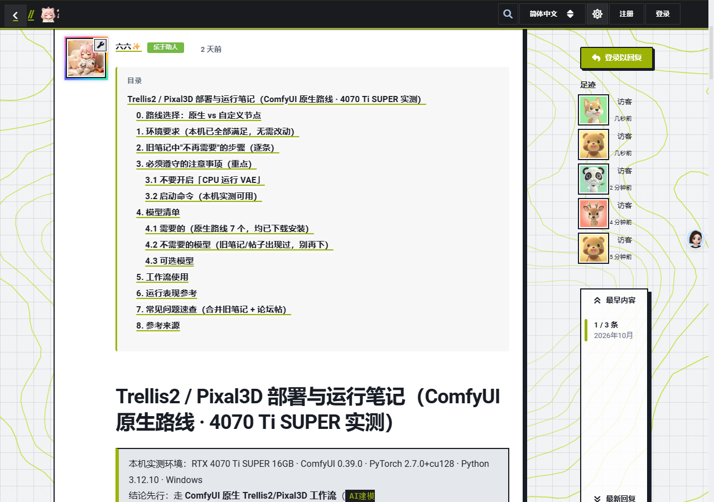
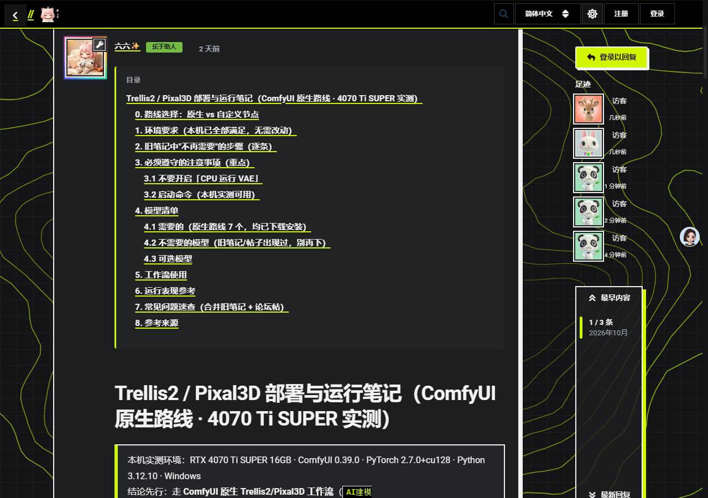
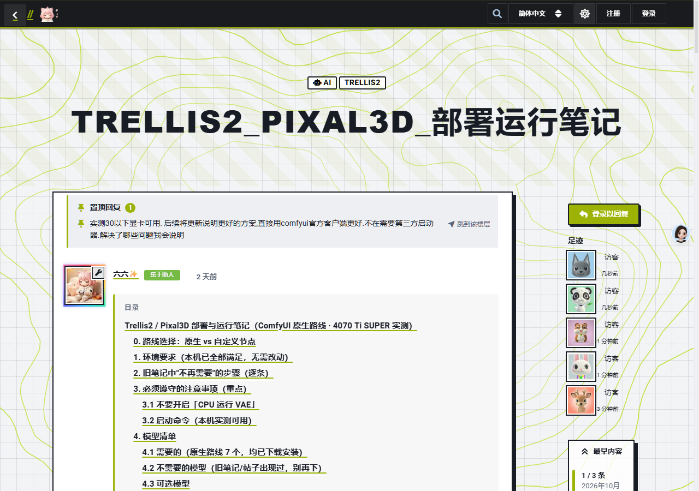

# ReplyPin 楼层置顶（liufencn/flarum-reply-pin）

把 Flarum 讨论内**任意一条回复楼层**钉到讨论页面顶部，并给被置顶的楼层加图钉徽标。

与官方 `flarum/sticky`（置顶整个讨论）不同，这里置顶的是**讨论内的单条回复**——常见于「修复公告」「最终结论」「资源总链接」这类需要让后来的读者第一眼看到的楼层。



## 功能

- **楼层置顶**：讨论内任意回复可置顶到帖子流顶部，形成「📌 置顶回复」区（摘要 + 跳到该楼层锚点）
- **图钉徽标**：被置顶的楼层加图钉左边框与标识
- **权限控制**：按讨论权限判断谁能置顶 / 取消置顶（`canPinReply`），访客看不到菜单项
- **多楼层支持**：同一讨论可置顶多条回复，按置顶时间排序
- **零核心改动**：纯扩展实现，不修改任何核心或 vendor 文件





## 安装

```bash
composer require liufencn/flarum-reply-pin
php flarum migrate
php flarum extension:enable liufencn-reply-pin
php flarum cache:clear
```

也可以手动部署：把本仓库放到 `extensions/` 下任意目录（建议与扩展 id 一致，如 `liufencn-reply-pin`），再在后台启用。扩展 id 为 `liufencn-reply-pin`。

## 使用

楼层「⋯」菜单 → **置顶回复 / 取消置顶**。置顶区出现在帖子流最顶部，未登录访客不可见该菜单。

## API

| 方法 | 端点 | 说明 |
|---|---|---|
| POST | `/api/reply-pin/pin` | 置顶（body：`{ postId }`） |
| POST | `/api/reply-pin/unpin` | 取消置顶（body：`{ postId }`） |
| GET | `/api/reply-pin/pinned?discussionId=<id>` | 列出该讨论被置顶的楼层 ID |

`Post` 资源注入 `isPinned` / `pinnedAt` / `canPinReply` 字段；`Discussion` 资源注入 `pinnedPostIds` 字段。

## 技术要点

- 数据库：`posts` 表新增 `is_pinned`（bool）与 `pinned_at`（datetime）两列
- 控制器写**全限定名**：`extend.php` 无 namespace 时，`use` 别名对 `::class` 不生效，相对名会让容器 `make()` 抛 Class not exist——这是 Flarum 2.0 手写扩展最常踩的坑
- `extend.php` 里的 `require_once` 让扩展在**无 composer autoload 的手动部署**下也能工作（composer 安装时由 PSR-4 接管，二者兼容）
- 前端为 Mithril 2 组件 + LESS，`module.exports = { extend: [] }` 缺失会中断整站 JS 启动

## 致谢

- [Flarum](https://flarum.org) — MIT

## License

**AGPL-3.0-or-later** — 可自由使用、修改、商用；但若你修改后对外提供服务，必须以相同许可开源你的改动。完整条款见 [LICENSE](LICENSE)。

## 联系作者 / Contact

| 渠道 | 地址 |
|---|---|
| 🏝️ 论坛（CatIsland） | https://bbs.cathi.cn |
| 💬 QQ 交流群 | 369748859 |
| 📮 邮箱 | 792818521@qq.com |
